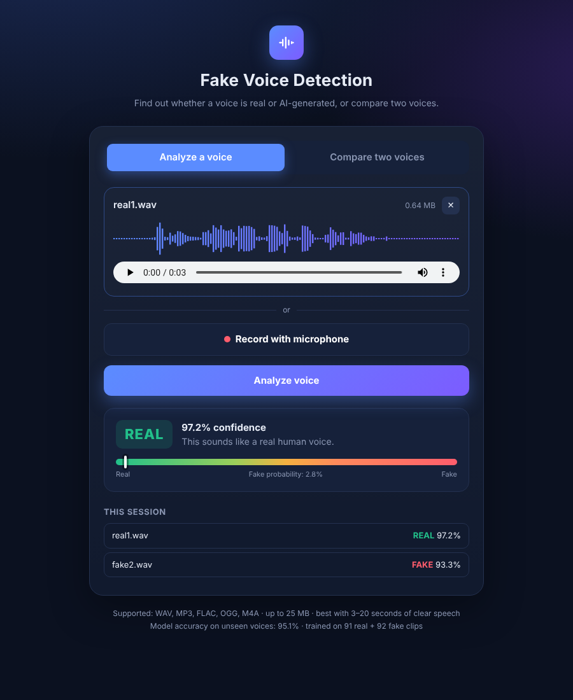
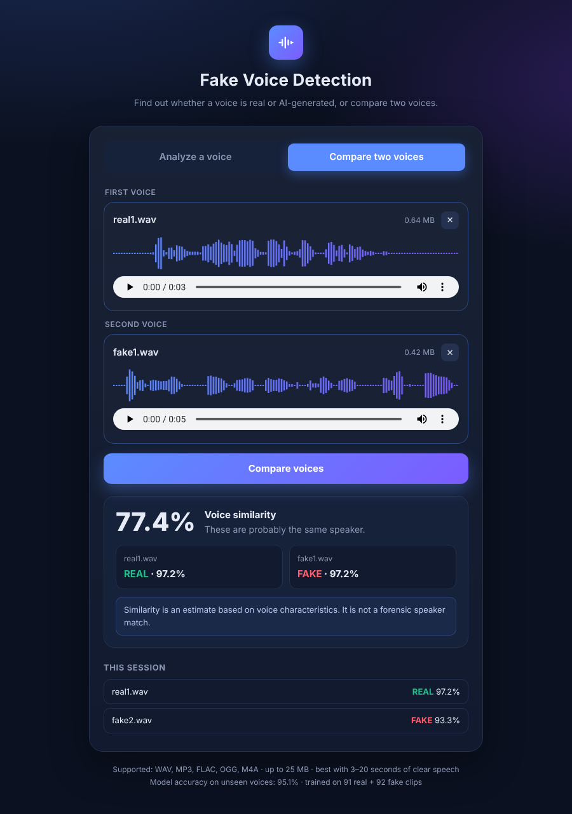

# 🎙️ Fake Voice Detection

Detects whether a voice recording is **real (human)** or **fake (AI-generated)**, and compares two voices. Built with Python, librosa, scikit-learn and Flask.

نظام يكشف إذا كان الصوت **حقيقي** أو **مولّد بالذكاء الاصطناعي**، ويقارن بين صوتين.



## النتائج

انقاست الدقة على **أصوات ما سمعها النموذج أبدًا** وقت التدريب. كل مرة نخبّي مجموعة أصوات كاملة عن النموذج، مثل كل ملفات صوت "Laura"، ونختبره عليها (5-fold grouped cross-validation).

| | النموذج الأساسي (24 خاصية + شبكة عصبية) | النموذج النهائي |
|---|---|---|
| الدقة | 88.3% | **95.1%** |
| ROC-AUC | — | **0.995** |
| الدقة مع ضوضاء | — | 90.7% |
| الدقة بعد ضغط MP3 | — | 89.6% |
| الدقة بجودة مكالمة | — | 92.9% |

## التشغيل

احتاجي Python 3.10 أو أحدث. جرّبته على Python 3.13.

```bash
git clone https://github.com/h7al0x-ctrl/fake-voice-detection.git
cd fake-voice-detection

python -m venv venv
venv\Scripts\activate          # على Mac/Linux: source venv/bin/activate
pip install -r requirements.txt

python app.py
```

المتصفح يفتح تلقائيًا على `http://127.0.0.1:5000`. النموذج المدرّب موجود في مجلد `model/`، فما تحتاجين تدرّبين من جديد.

### فحص ملفات من سطر الأوامر

```bash
python predict.py voice.wav
python predict.py my_folder/ --csv results.csv
```

### التدريب من جديد

البيانات الصوتية ما ترتفع على GitHub لأن حجمها كبير. رتّبيها كذا:

```
dataset/
├── REAL/    ← أصوات بشرية حقيقية
└── FAKE/    ← أصوات مولّدة بالذكاء الاصطناعي
```

وبعدين شغّلي:

```bash
python train.py
```

التدريب يطبع الدقة على أصوات جديدة، ويحفظ النموذج في `model/`. الصيغ المدعومة: WAV, MP3, FLAC, OGG.

## الملفات

| الملف | وظيفته |
|---|---|
| `features.py` | استخراج الخصائص الصوتية. ملف واحد يستخدمه التدريب والتنبؤ عشان ما يصير اختلاف بينهم |
| `train.py` | التدريب والتقييم، ويحفظ النموذج |
| `detector.py` | تحميل النموذج والتنبؤ والمقارنة |
| `app.py` | سيرفر Flask للواجهة |
| `predict.py` | الفحص من سطر الأوامر |
| `templates/index.html` | الواجهة |

## طريقة العمل

1. **تجهيز الصوت:** يتحول لقناة وحدة بتردد 16kHz، وينقص الصمت من البداية والنهاية، ويتوحّد مستوى الصوت. توحيد التردد مهم، لأن الأصوات الحقيقية في البيانات بتردد 32kHz والمزيّفة 44.1kHz، فبدونه ممكن النموذج يتعلم جودة الملف بدل الصوت نفسه.
2. **استخراج 228 خاصية:** MFCC مع التغيّر الأول والثاني، وLFCC، وخصائص طيفية (centroid, bandwidth, rolloff, flatness, contrast)، وZCR، والطاقة، وطبقة الصوت (pitch). ولكل خاصية نحسب المتوسط والانحراف المعياري.
3. **تكبير البيانات وقت التدريب:** كل ملف تنسوى منه 5 نسخ: ضوضاء، وتسريع، وإبطاء، وضغط MP3، وجودة مكالمة. عشان النموذج يتحمل التسجيلات الحقيقية.
4. **النموذج:** تصويت (soft voting) بين Logistic Regression وSVM وExtra Trees. اخترته بعد مقارنة 6 نماذج.
5. **مقارنة صوتين:** تشابه cosine بين "بصمة المتحدث" لكل صوت (MFCC + طبقة الصوت)، ويظهر معها حكم كل صوت لحاله.

## الواجهة

- رفع الملفات أو سحبها وإفلاتها.
- التسجيل من المايك مباشرة.
- شكل الموجة الصوتية ومشغّل للاستماع.
- مؤشر لاحتمال التزييف، وتنبيه إذا النتيجة قريبة من 50/50.
- مقارنة بين صوتين.
- سجل بنتائج الجلسة.



## حدود النموذج

- **البيانات صغيرة:** 91 صوت حقيقي و92 مزيّف.
- **كل الأصوات الحقيقية من مصدر واحد (Common Voice):** لذلك التسجيلات الحقيقية من مصادر ثانية، مثل مايك الجوال، ممكن تنفهم أحيانًا إنها مزيّفة.
- **المولّدات الجديدة صعبة عليه:** أغلب الأخطاء في أصوات مولّد ما شاف النموذج أمثلة منه.
- **نسبة التشابه في المقارنة تقديرية،** وما تصلح كدليل قاطع على هوية المتحدث.

## التطوير المستقبلي

- استخدام نماذج صوتية متدرّبة مسبقًا مثل wav2vec2 أو WavLM بدل الخصائص اليدوية.
- بيانات أكبر وأكثر تنوعًا: أصوات حقيقية من مصادر مختلفة، وأصوات مزيّفة من مولّدات أكثر.
